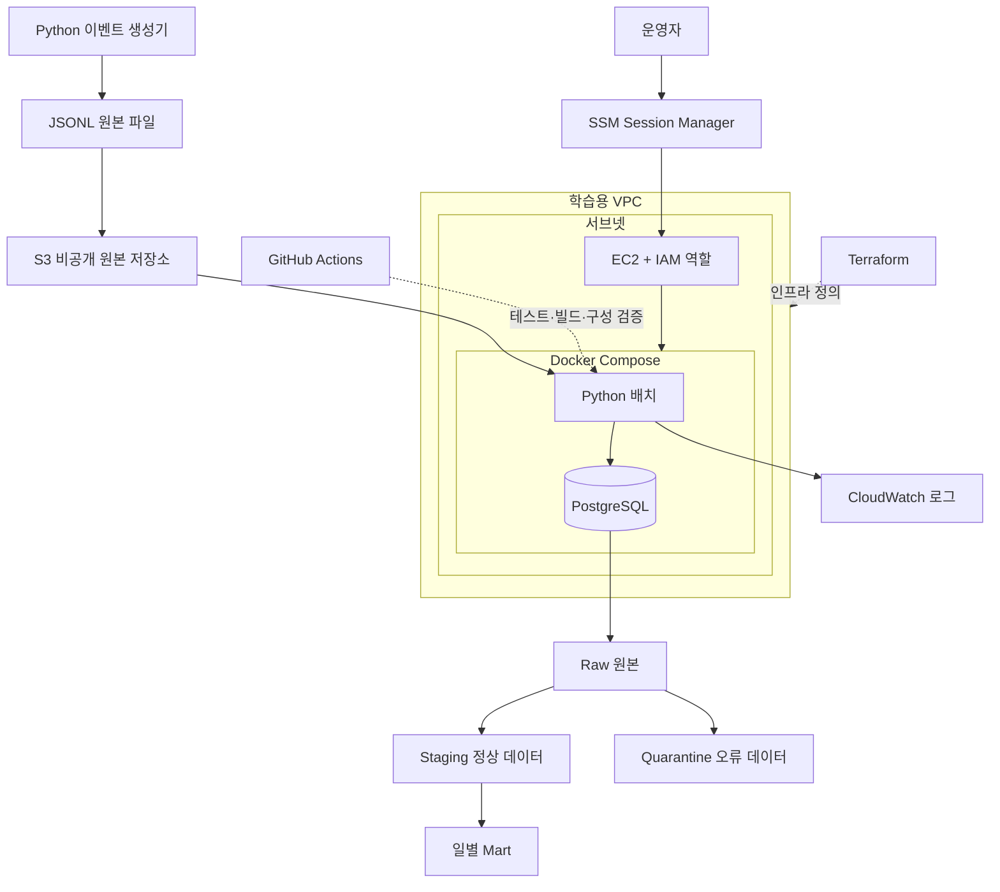

# SeatOps AWS 목표 아키텍처 — 설계 초안

**현재 배포된 구성도가 아닙니다.** 학습하면서 각 구성요소를 직접 설계·구현·검증할 목표입니다. 아래 후보를 정답으로 확정하지 않고 해당 과제에서 선택 이유를 기록합니다.

## 이 구성도를 사용하는 시점

이 문서의 AWS 구성은 **Phase 2의 목표**다. 먼저 Phase 1에서 AWS 없이 로컬 JSONL→PostgreSQL→Mart와 오류 처리·재처리·실행 이력·테스트·기본 CI를 완성한다. Phase 1 완료 전에는 이 구성도의 인프라를 만들지 않는다. Phase 2에서는 기존 처리 코드를 재사용해 EC2 실행과 S3 입출력·CloudWatch 연결을 학습한다.

## 서비스별 학습 목적과 대안

| 후보 | 필요한 이유 | 비교할 대안·주의점 |
|---|---|---|
| EC2 | Docker 배치를 직접 배포하고 프로세스·디스크·네트워크를 학습 | 관리형 서비스보다 직접 운영 책임이 큼 |
| S3 | 원본을 실행 호스트와 분리해 보관 | 로컬 파일은 단순하지만 호스트 손실과 함께 사라질 수 있음 |
| Compose PostgreSQL | 작은 규모에서 DB와 앱을 쉽게 재현 | RDS보다 저렴할 수 있지만 백업·복구·장애 대응을 직접 담당 |
| IAM instance role | 장기 키를 코드에 넣지 않고 권한 부여 | 권한 정책과 EC2의 역할 신뢰 정책을 구분해야 함 |
| VPC·Subnet·Route·SG | 통신 경로와 접근 제어를 명시 | public subnet이라는 이유만으로 포트가 열리는 것은 아님 |
| SSM | SSH 포트를 공개하지 않고 관리 | 운영자 권한·EC2 역할·agent·outbound 연결이 필요 |
| CloudWatch | 호스트 밖에서 실행·오류 로그 확인 | 초기에는 로컬 로그로 형식을 먼저 검증; 보존·수집 비용 고려 |
| Terraform | 생성 이유·변경·삭제를 코드로 재현 | 콘솔 실습은 이해에 도움되지만 최종 구성과 drift 관리 필요 |
| GitHub Actions | 코드 변경 시 자동 검증 | CI와 실제 AWS 배포는 별도 단계 |

## 단계에서 직접 결정할 항목

### 네트워크·보안

- 서브넷, EC2, 인터넷/AWS API의 통신 경로를 직접 그린다.
- 퍼블릭 서브넷+공인 IPv4+IGW+인바운드 없는 SG를 작은 MVP 후보로 검토한다. NAT Gateway 비용을 피하는 대신 공인 IPv4 비용과 인터넷 outbound를 고려한다.
- PostgreSQL 포트는 외부 인터넷에 공개하지 않는다. SSM을 우선 검토한다.
- EC2 역할의 S3 대상 bucket/prefix와 로그 권한을 필요한 만큼 정한다.
- S3 Public Access Block과 암호화, IMDSv2를 검토한다. 컨테이너에서 EC2 역할을 사용하는 방법은 해당 단계에서 공식 문서를 확인한다.

### 데이터와 재처리

- Raw 한 행의 의미, 원본 보존 형식, 파일/이벤트 중복 식별 키를 학습자가 먼저 제안한다.
- Staging의 유일성, Quarantine 오류 코드와 수정 이력 연결 방법을 결정한다.
- Mart의 날짜 기준·Grain·성공률 분모와 0건 처리 방법을 결정한다.
- 작업 중간 실패 시 어떤 데이터가 남아야 하는지 적고 트랜잭션 경계를 설계한다.
- 동일 입력 재실행과 오류 수정 재처리를 구분해 테스트한다.

### 내구성·비용

- named volume은 컨테이너 재생성과 EC2 종료에서 수명이 다르다. EC2의 EBS 삭제 설정과 백업 필요성을 직접 설명한다.
- S3 원본만으로 복구할 수 있는 데이터와 별도 DB 백업이 필요한 이력을 구분한다.
- EC2 실행 시간, EBS 용량, 공인 IPv4, S3 용량/요청, CloudWatch 로그/지표 비용을 배포 직전에 확인한다. 무료 티어를 보장하지 않는다.
- Terraform state·실제 tfvars·비밀번호·키는 Git에 넣지 않는다. 삭제할 리소스와 보존할 증거를 분리한다.

## 승인 및 검증 경계

현재 AWS 리소스는 이 프로젝트 계획에 따라 생성하지 않았습니다. 실제 생성·업로드 등 비용 발생 작업은 대상 계정·리전·예상 비용을 확인하고 승인받은 뒤 수행합니다. 모의 테스트나 아키텍처 문서만으로 AWS 운영 성공을 주장하지 않습니다.

설계 결정을 실제로 내릴 때 ADR을 작성합니다. 아직 본인이 선택하지 않은 사항을 본인의 결정·구현 경험으로 기록하지 않습니다.
